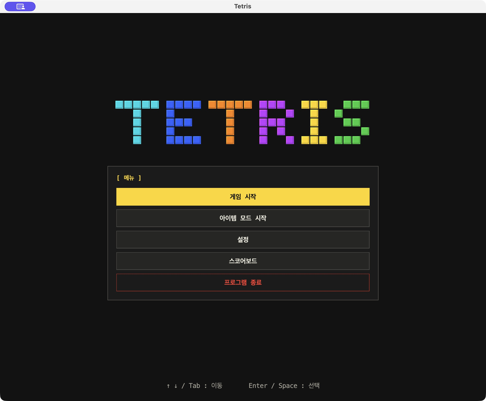

# Tetris

Java 21과 Swing으로 만든 테트리스다. 일반 모드와 아이템 모드, 난이도 3단계, 색각 모드 5종, 설정·점수 저장을 제공한다.



## 다운로드와 실행

중간평가 기능 기준은 main `3ccf291`이다. Java 실행 환경과 아이콘이 포함되어 별도 명령 입력 없이 실행할 수 있다.

| 환경 | 다운로드 | 실행 |
|---|---|---|
| Windows x64 | [Windows 실행 패키지](https://github.com/dark-ran/tetris-team-project/actions/runs/40358235959/artifacts/12666981899) | 압축 해제 후 `Tetris/Tetris.exe` |
| macOS Apple Silicon | [macOS arm64 실행 패키지](https://github.com/dark-ran/tetris-team-project/actions/runs/40358236283/artifacts/12667121964) | 압축 해제 후 `Tetris.app` |

GitHub 로그인 후 Artifact를 받는다. 바깥 ZIP 안의 게임 ZIP도 해제하고 실행파일을 더블클릭한다. Windows는 Tetris 폴더 전체를 유지한다. 패키지 선택·다시 만들기·macOS 첫 실행 안내는 [배포 문서](docs/distribution.md)에 정리한다.

macOS arm64는 앱 실행·조작·설정과 점수 유지를 확인했다. Windows는 자동 검사·패키지 생성까지 확인했으며 실제 PC 실행 결과는 별도로 확인한다.

## 게임과 조작

보드는 20×10이다. I·O·T·S·Z·J·L의 기본 모양, 다음 블록 한 개, 착지 예상 위치, 실시간 점수와 레벨을 표시한다. 아이템 모드에서는 삭제한 줄 수와 다음 아이템까지 남은 줄 수도 표시한다.


| 기본 키 | 동작 |
|---|---|
| ← / → / ↓ | 좌우·아래 한 칸 이동 |
| ↑ | 시계방향 90도 회전 |
| Space | 즉시 낙하 |
| Esc | 게임 메뉴·일시정지 |
| Q | 게임 중 프로그램 종료 |
| 메뉴의 ↑ / ↓ / Tab, Enter | 항목 이동·선택 |

설정에서 조작 키를 바꿀 수 있다. 게임 메뉴에서 재개·설정·시작 메뉴·종료를 선택한다. 기본 자동 낙하는 1초이며 진행에 따라 빨라진다.

## 아이템 모드

실제 누적 10줄마다 새 미리보기에 아이템을 지급한다. 이미 보였던 블록은 유지하고, 아이템은 미리보기에 나타난 모양과 문자 그대로 생성한다. 5종은 각각 20%이며 일반 모드에는 등장하지 않는다.


| 아이템 | 규칙 |
|---|---|
| L · 줄 삭제 | 일반 모양의 무작위 한 칸에 부착. 고정 시 L이 있는 행 삭제, 일반 점수 |
| W · 무게추 | 너비 4칸. 아래 고정 칸을 지우며 낙하, 첫 접촉 후 좌우 이동 금지, 0점 |
| B · 폭탄 | 가로 3칸. 접촉 위치로 중심을 정해 최대 5×5 삭제, 0점 |
| G · 황금 블록 | 일반 모양의 모든 칸에 G. 포함된 행을 지울 때 해당 줄 삭제 점수 5배 |
| 1 · 1칸 블록 | 한 칸. 자동 낙하·이동·즉시 낙하와 일반 점수 유지 |

L·G는 일반 블록처럼 회전한다. W·B는 회전하지 않는다. G의 배율은 낙하 점수나 줄 수를 늘리지 않으며, B·W가 지운 개별 칸은 10줄 보상에 포함하지 않는다. [아이템 모양·접촉·점수 상세](docs/game-guide.md#아이템-등장)

## 난이도·설정·기록

| 난이도 | I 가중치 / 다른 블록 각각 | 레벨당 낙하 간격 감소 |
|---|---|---|
| EASY | 12 / 10 | 80ms |
| NORMAL | 10 / 10 | 100ms |
| HARD | 8 / 10 | 120ms |

설정은 다음 게임부터 적용한다. 레벨은 생성 블록 수와 삭제 줄 수 중 더 높은 진행값을 10단위로 반영하며 최소 낙하 간격은 100ms다. 기본 낙하 칸당 1점, 가속 상태에서는 2점이다. 1·2·3·4줄 삭제 보너스는 100·300·500·800점이다.

창 크기 3종, 색각 모드 5종, 독립 패턴, 키 설정, 기본값 복구와 기록 초기화를 제공한다. 일반·아이템 모드별 상위 10개를 저장하고 점수판에 획득 난이도를 표시한다. 등록한 새 기록은 강조한다.


설정은 사용자 홈의 `.tetris/settings.properties`, 점수는 `.tetris-team-project/scores.tsv`에 저장한다. 이전 버전의 점수 파일도 읽을 수 있다. [전체 사용 방법](docs/game-guide.md)

## 빌드와 검사

개발에는 JDK 21을 사용한다. Gradle Wrapper가 포함되어 있다.

```bash
./gradlew run
./gradlew --no-daemon clean build jacocoTestReport
./gradlew reviewWindowTest
./gradlew gameplayPerformanceTest
./gradlew packageMacos
```

Windows는 `.\gradlew.bat`을 사용하고 `packageWindows`로 exe를 만든다. 앱은 `build/macos/Tetris.app`, Windows 실행파일은 `build/windows/Tetris/Tetris.exe`에 생성한다. `build/`는 Git에 넣지 않는다.

2026-10-27 검증: 단위 541개·통합 1개·실제 창 9개·성능 6개 통과. 전체 줄 커버리지 **93.50%**, 분기 **84.45%**다. 실제 생성 코드의 난이도별 100,000회 분포와 아이템 100,000회 분포는 기대 횟수 대비 상대오차 5% 이내를 통과했다.

Ubuntu·Windows·macOS CI에서 `build`와 커버리지를 검사한다. 상세 보고서는 [통합 검증](docs/verification.md), 명령과 보고서 위치는 [개발 안내](docs/development.md)에 정리한다.

## 요구사항·설계·작업 이력

기본 게임·입력·설정·기록·배포는 Req1에 연결하고, 난이도·확률·애니메이션·아이템 5종과 모드별 기록은 Req2로 확장했다. 새 아이템은 공통 모양 정보와 이동·고정 효과를 조합하여 연결한다.

- [Req1·Req2 대응표](docs/requirements.md): 요구 항목별 코드·테스트·PR.
- [게임 구조와 확장 방법](docs/architecture.md): 책임 분리와 아이템 처리 순서.
- [담당 이력과 작업 현황](docs/req2-team-plan.md): 기능별 작성 계정·병합 PR·남은 장비 확인.
- [대표 이슈 #19](https://github.com/dark-ran/tetris-team-project/issues/19): 구현·배포 확인 상태.
- [중간평가 확인 현황](docs/peer-review-readiness.md): 준비 상태와 증거 문서.
- [모듈 연결 명세](docs/contracts/README.md): L·W·B·G·1과 점수 저장 규칙.
