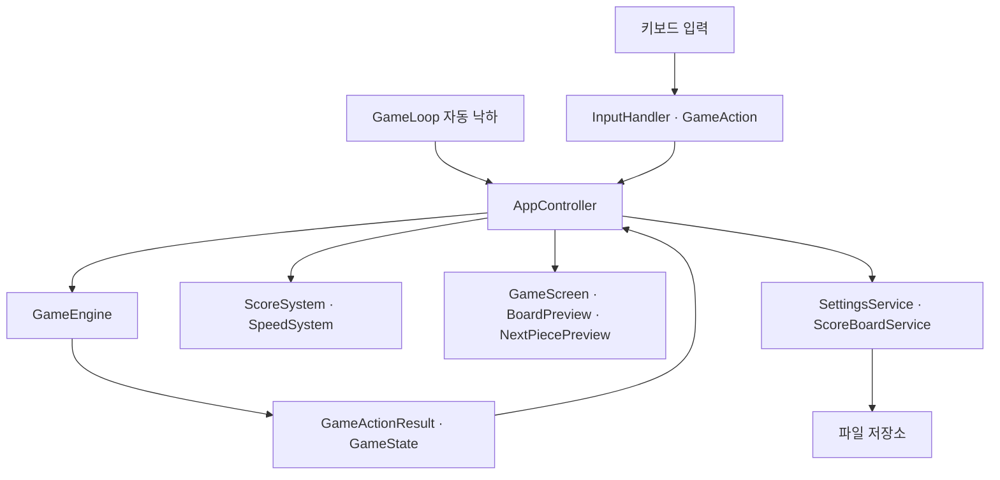

# 게임 구조와 아이템 확장

게임 규칙, 화면, 입력·타이머, 파일 저장을 분리한다. 게임 엔진은 Swing 창이나 저장 파일을 알지 않으며, 화면은 엔진 상태의 사본을 받아 그린다.

## 호출 흐름

입력과 타이머는 Swing EDT에서 순서대로 처리한다. 엔진이 행동 결과를 반환하면 앱 제어가 점수·속도를 계산하고 화면을 갱신한다. 화면 상태는 AppState, 게임 진행은 GamePhase로 관리한다.

| 영역 | 책임 | 주요 코드 |
|---|---|---|
| 보드 | 충돌, 고정 칸·아이템 속성, 행·영역 삭제, 상태 사본 | Board |
| 블록 | 모양·회전·아이템 표시 위치, 난이도별 큐, 보상 종류 선택 | Tetromino, PieceQueue, ItemGenerator |
| 엔진 | 이동·고정·삭제·새 블록·게임오버, 10줄 보상 | GameEngine, GameState, GameActionResult |
| 규칙 | 이동 방식, 고정 효과, 점수 허용·소멸, 줄 삭제 배율 | PieceRules, PieceMovement, LockEffect, LineClearBonus |
| 앱 제어 | 입력·자동 낙하 연결, 점수·속도 적용, 화면·저장 흐름 | AppController, GameLoop |
| 화면 | 보드·미리보기·아이템 문자·애니메이션, 메뉴·설정·기록 | ui 패키지 |
| 저장 | 설정·점수 검증, 파일 호환, 원자적 교체와 재시도 | settings, scoreboard 패키지 |

## 아이템 정보를 한 객체로 전달

Tetromino에는 기본 종류뿐 아니라 실제 칸 좌표, 아이템 종류, 표시 위치가 있다. PieceQueue는 이 객체 전체를 보관한다. 미리보기와 실제 생성이 같은 정보를 사용하므로 L 부착 위치, 무게추의 6칸, 폭탄의 3칸, 1칸 모양이 유지된다.

Board는 고정 칸의 기본 값과 아이템 속성을 함께 보관한다. 복사·고정·줄 이동·영역 삭제·초기화에서도 두 정보를 함께 처리한다. 황금 블록은 고정된 뒤 다른 블록이 줄을 완성해도 배율을 적용할 수 있다.

## 이동과 효과를 분리

PieceRules는 다음 네 가지를 조합한다.

- PieceMovement: 낙하·회전·좌우 이동·접촉 후 행동.
- LockEffect: 고정 시 보드 변경, 삭제할 행, 효과 중심 조회.
- awardsScore: 낙하와 삭제에 점수를 부여할지.
- leavesPieceOnBoard: 고정 칸으로 남길지.

일반·G·1은 기본 이동을 공유한다. L은 기본 이동에 지정 행 삭제 효과를 붙인다. W는 아래 칸을 제거하는 이동과 점수 없는 소멸을 사용한다. B는 회전을 막는 이동과 영역 삭제 효과를 사용한다. 엔진에 아이템별 switch를 추가하지 않고 등록한 규칙을 호출한다.

## 고정과 보상 처리 순서

1. 남기는 블록이면 보드에 고정한다.
2. 고정 효과로 영역을 변경하고 삭제할 행을 구한다.
3. 삭제 전 행의 G 속성으로 줄 삭제 배율을 구한다.
4. 대상 행을 중복 없이 삭제하고 실제 줄 수를 누적한다.
5. 새로 넘은 10줄 경계 수만큼 아이템을 예약한다.
6. 기존 미리보기 블록을 생성하고 새 미리보기에 예약 아이템을 적용한다.
7. 앱 제어가 낙하·줄 점수와 난이도별 속도를 반영하고 화면을 갱신한다.

폭탄·무게추의 개별 칸 삭제는 줄 수 보상과 분리한다. 황금 배율은 줄 삭제 점수에만 적용한다.

## 새 아이템 추가 절차

1. ItemType에 문자와 표시 속성을 추가한다.
2. Tetromino의 실제 모양 또는 기존 모양의 부착 방법을 정의한다.
3. 공통 이동·효과로 충분하면 재사용하고, 다르면 PieceMovement 또는 LockEffect를 구현한다.
4. PieceRules와 ItemGenerator에 등록한다.
5. 보상 → 미리보기 → 실제 생성 → 발동·점수 → 재시작을 연결 테스트한다.
6. 색각 모드와 경계·충돌·기존 아이템 상호작용을 확인하고 명세에 추가한다.

## 설계에서 개선한 점과 남은 경계

블록 종류만 전달하던 연결을 실제 모양·아이템 위치를 포함한 전달로 확장했다. 이동과 고정 효과를 분리하여 무게추·폭탄을 추가해도 기본 이동 코드를 복제하지 않도록 했다. 화면과 점수 저장도 같은 모드·난이도 정보를 사용한다.

현재 줄 삭제 화면은 이전 상태와 새 상태를 비교해 삭제 전 장면을 복원한다. 새로운 복합 효과가 많아지면 엔진 결과에 삭제 행·효과 범위·연출 순서를 담은 사건 목록을 제공하는 편이 유지보수에 유리하다. 이는 다음 확장 시 검토할 개선이며 현재 게임의 동작은 [검증 결과](verification.md)에서 확인한다.
