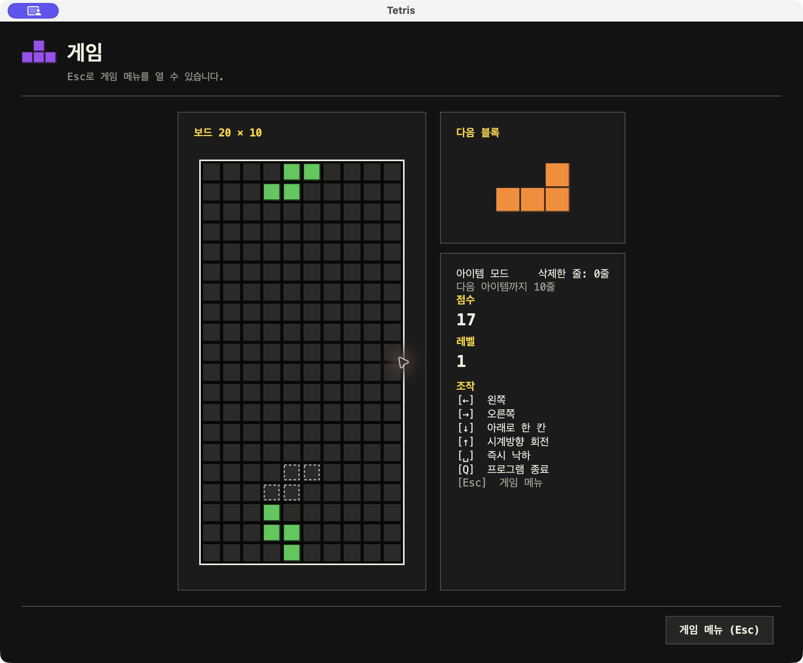
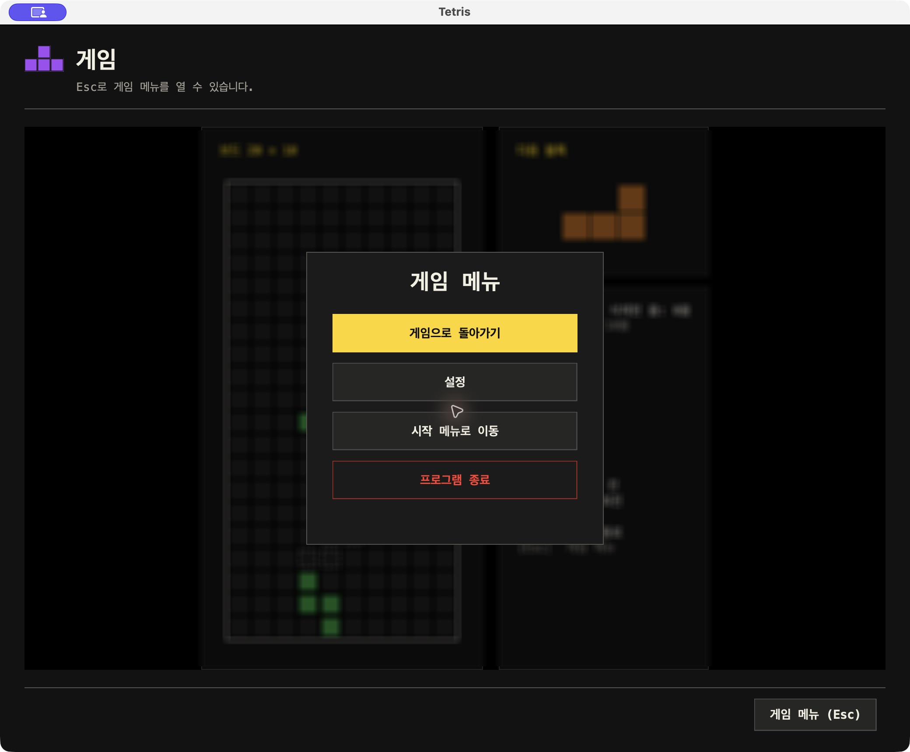
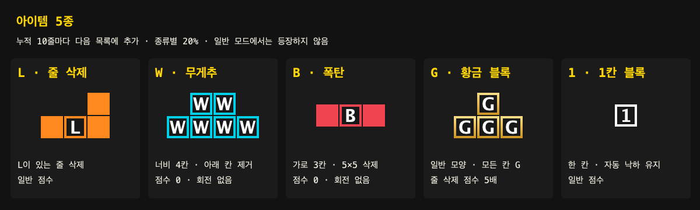
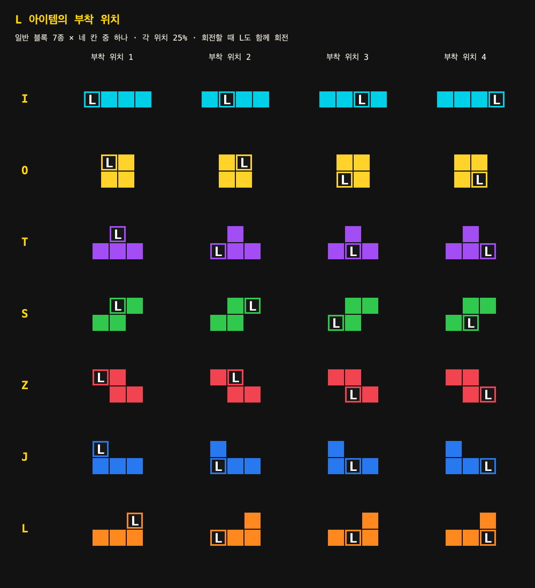
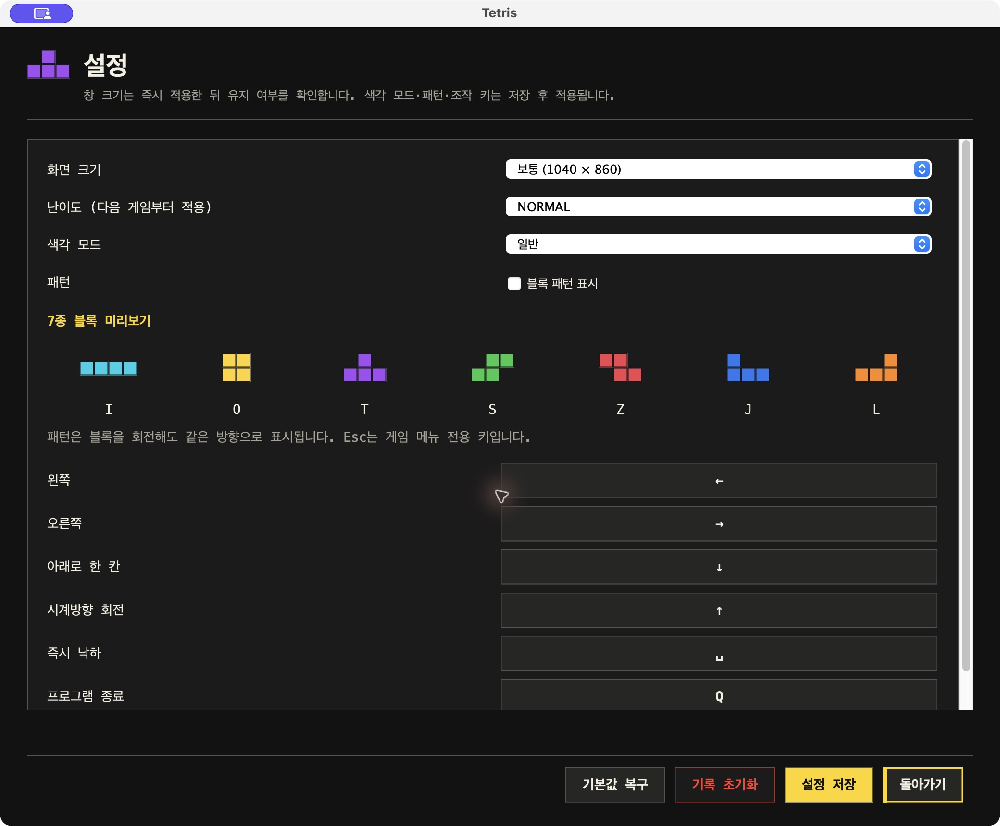
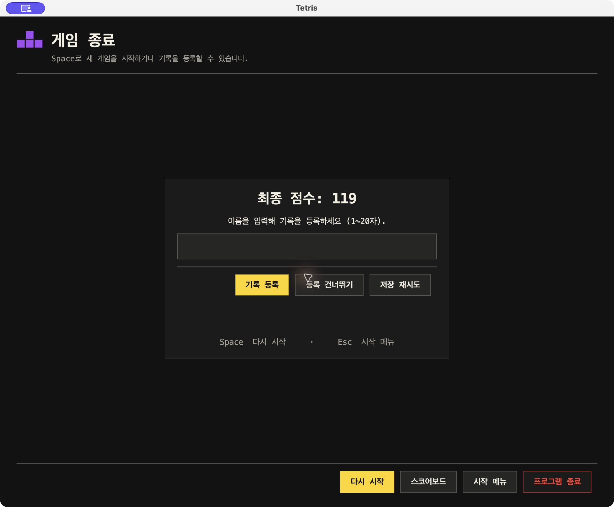
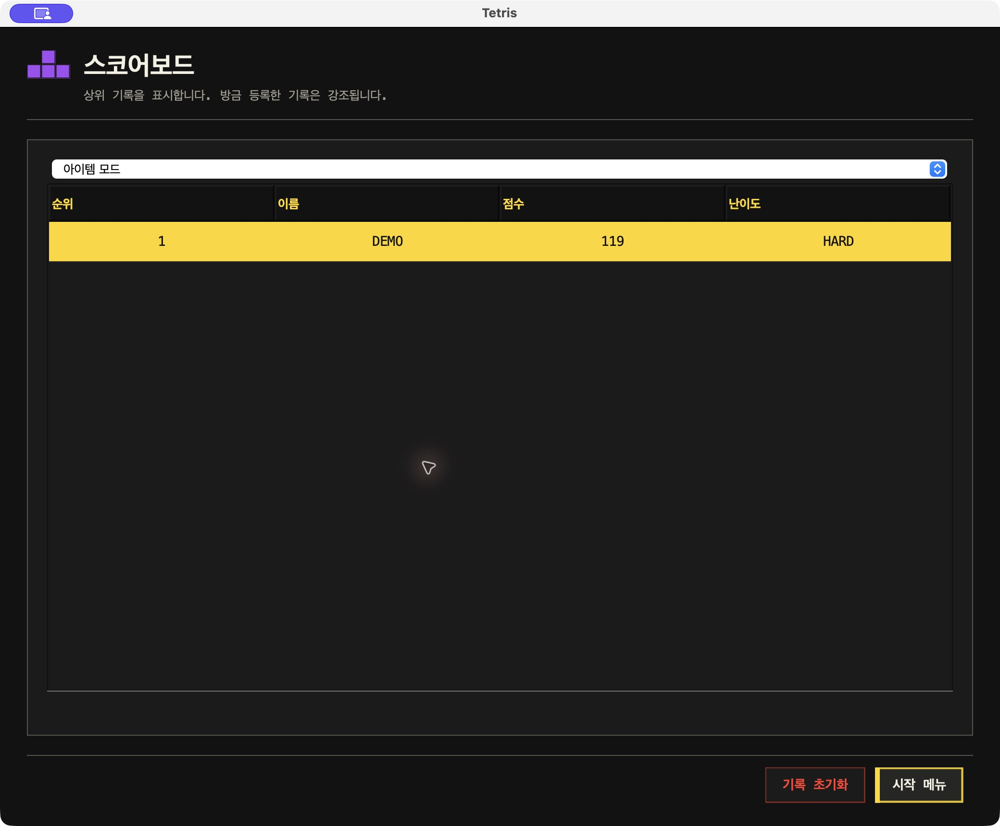

# 게임 안내

## 화면과 조작

시작 메뉴에서 일반 모드 또는 아이템 모드를 선택한다. 일반 모드는 기본 블록 7종으로 진행한다. 아이템 모드는 같은 게임 규칙에 10줄 보상 아이템을 추가한다. 두 모드의 점수 기록은 따로 관리한다.

보드는 20행 × 10열이다. 오른쪽에는 다음 블록 한 개, 현재 점수, 레벨과 조작 키를 표시한다. 아이템 모드에서는 삭제한 줄 수와 다음 아이템까지 남은 줄 수도 표시한다. 점선은 현재 블록의 착지 예상 위치다.

| 기본 키 | 동작 |
|---|---|
| ← / → | 좌우 한 칸 이동 |
| ↓ | 아래로 한 칸 이동 |
| ↑ | 시계방향 90도 회전 |
| Space | 즉시 낙하 |
| Esc | 게임 메뉴를 열어 일시정지 |
| Q | 게임 중 프로그램 종료 |
| 메뉴의 ↑ / ↓ / Tab | 항목 이동 |
| Enter / Space | 선택한 메뉴 실행 |

게임 메뉴의 ‘게임으로 돌아가기’로 재개한다. 설정, 시작 메뉴, 프로그램 종료도 선택할 수 있다. 조작 키는 설정에서 바꿀 수 있으며 Esc는 게임 메뉴 전용이다. 중복 키와 Esc 지정은 허용하지 않는다.

## 난이도와 속도

설정에서 EASY·NORMAL·HARD를 선택한다. 저장한 난이도는 다음 게임부터 적용하며, 진행 중 설정을 바꾸어도 현재 게임의 난이도와 기록은 유지한다.

| 난이도 | I 가중치 | 나머지 각 블록 가중치 | I 선택 확률 | 레벨당 낙하 간격 감소 |
|---|---:|---:|---:|---:|
| EASY | 12 | 10 | 12/72 = 약 16.67% | 80ms |
| NORMAL | 10 | 10 | 10/70 = 약 14.29% | 100ms |
| HARD | 8 | 10 | 8/68 = 약 11.76% | 120ms |

초기 자동 낙하는 1초에 한 칸이다. 레벨은 `1 + max(생성 블록 수 ÷ 10, 삭제 줄 수 ÷ 10)`의 정수 부분으로 계산한다. 낙하 간격은 레벨마다 위 표만큼 줄어들며 최소 100ms다. 가중치는 선택 비율이므로 EASY의 I 확률이 20%라는 뜻은 아니다.

## 점수와 줄 삭제

자동·수동 낙하 모두 실제로 내려간 칸당 1점을 얻는다. 자동 낙하 간격이 초기 1초보다 짧아지면 칸당 2점을 얻는다. 즉시 낙하도 실제 이동 거리로 계산하며 별도 배율은 없다.

| 한 번에 삭제한 줄 | 1줄 | 2줄 | 3줄 | 4줄 |
|---|---:|---:|---:|---:|
| 기본 줄 삭제 점수 | 100 | 300 | 500 | 800 |

삭제 대상 줄은 약 350ms 동안 한 번 반짝인다. 연출 중 약 400ms 동안 자동 낙하와 게임 조작을 보류한다. 재시작·화면 이탈 시 이전 연출을 취소한다.

## 아이템 등장

아이템 모드에서 실제로 삭제한 줄이 누적 10·20·30줄에 도달할 때마다 아이템 한 개를 지급한다. L로 삭제한 줄과 1칸 블록으로 완성한 줄도 포함한다. 폭탄·무게추로 지운 개별 칸은 줄 수에 포함하지 않는다.

보상은 새로 추가되는 다음 블록에 적용한다. 이미 미리보기에 있던 일반 블록은 그대로 생성되고, 새 아이템이 미리보기에 나타난 뒤 그 모양·문자 그대로 생성된다. 난이도는 일반 블록의 모양 선택에 적용하며, 보상 아이템 5종은 각각 20%다.

| 문자 | 아이템 | 모양·동작 | 점수 |
|---|---|---|---|
| L | 줄 삭제 | 일반 블록의 무작위 한 칸에 부착. 고정할 때 L이 있는 행을 빈칸이 있어도 삭제 | 일반 낙하·줄 삭제 점수 |
| W | 무게추 | 위 2칸·아래 4칸, 너비 4칸. 아래 블록을 지우며 낙하. 첫 접촉 후 좌우 이동 금지, 회전 없음 | 0점 |
| B | 폭탄 | 가로 3칸, 중앙에 B. 고정할 때 최대 5×5 영역 삭제, 회전 없음 | 0점 |
| G | 황금 블록 | 일반 7종 모양의 모든 칸에 황금색과 G. 이동·회전 가능 | G가 포함된 줄 삭제 처리의 점수 5배 |
| 1 | 1칸 블록 | 한 칸. 기존 자동 낙하·이동·즉시 낙하 유지. 회전해도 모양 동일 | 일반 낙하·줄 삭제 점수 |

### L의 위치

L은 일반 모양의 네 칸 중 한 칸에 같은 확률(각 25%)로 붙는다. 회전하면 L 위치도 함께 회전한다. L이라는 표시는 기본 L자 모양과 별개이므로 I·O·T·S·Z·J·L 모양 모두에 붙는다. 지정 행과 동시에 완성된 다른 행은 중복 없이 함께 삭제한다.

### 무게추의 접촉

처음에는 좌우 이동이 가능하다. 아래에 고정 블록이나 바닥이 닿는 순간부터 좌우 이동을 막는다. 아래의 고정 칸을 지우면서 계속 내려가고 바닥에서 사라진다. 무게추 자체는 고정 칸으로 남지 않는다. 자세한 경계 규칙은 [무게추 명세](contracts/weight-item.md)에 정리한다.

### 폭탄의 중심

세 칸 중 어느 칸이든 아래가 막히면 더 내려가지 않는다. 고정할 때 가운데가 닿으면 가운데, 한쪽 끝만 닿으면 그 끝, 양끝만 동시에 닿으면 가운데를 중심으로 삼는다. 바닥에서는 가운데를 사용한다.

중심은 폭탄 자신의 칸이며 상하좌우 각 2칸, 최대 5×5를 삭제한다. 보드 밖은 제외하고 범위 밖 블록은 이동시키지 않는다. 착지 예상 위치의 노란 실선은 폭발 중심이다. 폭탄은 고정 칸으로 남지 않는다. [접촉·폭발 상세](contracts/bomb-item.md)

### 황금 블록의 점수

한 번에 지우는 줄 중 G가 하나라도 있으면 그 처리의 줄 삭제 점수를 한 번만 5배 적용한다. 예를 들어 두 줄을 함께 삭제하고 그중 한 줄에 G가 있으면 300×5 = 1,500점이다. G가 여러 개라도 25배로 늘어나지 않는다.

낙하 점수와 누적 삭제 줄 수에는 배율을 적용하지 않는다. L이 G가 있는 행을 지워도 같은 배율을 적용한다. 폭탄·무게추가 G 칸을 개별 삭제하면 0점이다. 삭제되지 않은 G는 고정·줄 이동 후에도 유지한다. [황금 블록 상세](contracts/golden-item.md)

## 설정

창 크기 3종(900×760, 1040×860, 1280×1024), 난이도, 조작 키, 색각 모드, 블록 패턴을 설정한다. 색각 모드는 일반·적색 계열 보정·녹색 계열 보정·청황 계열 보정·단색의 5종이다. 패턴은 별도로 켜고 끌 수 있으며 아이템 문자는 어느 모드에서도 표시한다.

창 크기는 즉시 미리 적용하고 유지 여부를 확인한다. 나머지는 ‘설정 저장’으로 반영한다. ‘기본값 복구’는 설정을 기본값으로 되돌리며, ‘기록 초기화’는 두 모드의 점수 기록을 지운다.

## 게임 종료와 기록

더 이상 블록을 생성할 수 없으면 게임을 종료한다. 해당 모드의 상위 10위에 들어가는 점수는 이름 입력 후 등록할 수 있다. 이름은 앞뒤 공백을 제외한 1~20자로 제한한다. 등록하면 점수판으로 이동하여 새 기록을 강조한다.

일반 모드와 아이템 모드는 각각 상위 10개를 저장한다. 점수판에는 순위·이름·점수·획득 난이도를 표시한다. 각 모드 안에서는 난이도를 함께 비교하며, 난이도별 별도 순위표는 제공하지 않는다. 동점은 먼저 등록된 기록을 앞에 둔다. 10개가 찬 경우 마지막 점수보다 높아야 등록한다.

파일은 사용자별로 저장하므로 앱을 이동하거나 다시 실행해도 유지된다.

| 데이터 | 위치 |
|---|---|
| 설정 | 사용자 홈의 `.tetris/settings.properties` |
| 점수 | 사용자 홈의 `.tetris-team-project/scores.tsv` |

점수 파일은 이름·점수·모드·난이도를 저장하는 UTF-8 형식이다. 이전 파일의 난이도 없는 기록은 NORMAL로 읽는다. 저장에 실패하면 오류와 재시도를 제공하며 기존 정상 기록을 보호한다.
