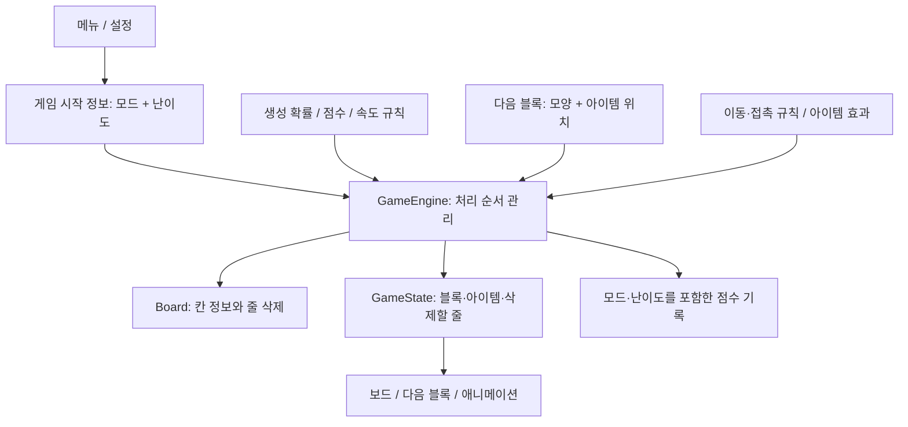

# 상호평가 전에 해야 할 일

확인일: 2026-10-22. 기준 소스: `main`의 `14be47d`.
Req1·Req2, 아키텍처 설계 강의, 소프트웨어 테스트 강의와 실제 코드를 대조했다.
정확한 평가 날짜와 Req2 구현 완료 범위는 교수님 공지를 기준으로 확인한다.
교수님 발언만으로 다음 주까지 Req2 전체 구현이 필수라고 단정하지 않는다.

팀원 아이템 후보의 구분·우선순위·담당 범위와 OS별 검증은
[팀원 의견을 기준으로 나눈 진행안](req2-team-plan.md)에 추가했다.
이 문서의 기존 아이템 후보는 초기 제안이며 새 진행안과 함께 검토한다.

## 먼저 내릴 수 있는 판단

기본 게임은 자동 테스트가 충분히 되어 있다. 다음 우선순위는 아이템 확장 설계와 실행 패키지다.
화면과 엔진을 분리한 방향은 좋지만, 현재 데이터와 처리 순서는 일반 블록에 맞춰져 있다.
아이템 메뉴만 추가해서 해결되지는 않는다. 아이템의 위치·모양·이동 규칙이 엔진부터 미리보기까지 전달되어야 한다.

| 항목 | 확인된 상태 | 필요한 일 |
|---|---|---|
| 기본 게임 | 단위 테스트 346개, 통합 테스트 1개 통과 | 기능을 바꿀 때 기존 테스트 유지 |
| 전체 줄 커버리지 | 1,685/1,817줄, **92.74%** | 전체 50% 미만이면 빌드 실패하도록 검사 연결 |
| 분기 커버리지 | 520/637개, 81.63% | 숫자만으로 모든 동작이 맞다고 판단하지 않기 |
| 비기능 테스트 | 256 MiB 힙 제한에서 성능 테스트 6개 통과 | 평가 PC의 실제 실행 결과도 남기기 |
| 아이템 모드 | 현재 소스에 없음 | 데이터·큐·충돌·효과·UI·저장 설계 후 구현 |
| 난이도 / 삭제 애니메이션 | 현재 소스에 없음 | Req2의 일반 모드 변경도 함께 계획 |
| macOS 실행파일 | 기존 main에 생성 체계 없음 | 이번 변경의 `packageMacos`로 생성 후 실제 실행 확인 |
| Windows 실행파일 | 열린 PR #15에 패키지가 있음 | 병합·배포 상태 확인, 생성 절차도 기록 |
| 커버리지 표시 개선 | 열린 PR #13, 이슈 #12 | 최신 main 기준으로 갱신하고 검토 |

커버리지는 **전체 main 클래스와 단위 테스트 실행 데이터**로 계산했다. UI와 Main을 제외하지 않았다.
통합·성능 테스트 실행 데이터는 이 수치에 합치지 않았다. `Main`은 0/18줄로 포함된다.
Req2 12쪽은 중간평가 50%, 기말평가 70%를 명시한다.
보드·엔진 일부 클래스가 70%를 넘는 것과 전체 코드가 50%를 넘는 것은 별개의 검사다.

## 현재 구조의 좋은 점과 어려운 점

좋은 점은 `GameEngine`이 Swing이나 파일 저장을 모르며,
`GameState`로 화면에 상태 사본을 전달한다는 것이다.
난수 생성기와 시작 위치 정책을 바꿔 끼울 수 있어 테스트하기도 쉽다.
점수와 속도 계산도 `rule`로 분리되어 있다. 이 구분을 유지한다.

| 실제 코드 | 아이템을 추가할 때 생기는 문제 | 작은 변경 방향 |
|---|---|---|
| `PieceQueue`가 `PieceType`만 저장 | 같은 T 모양이라도 L 아이템이 붙은 위치를 미리보기에 전달할 수 없음 | 모양과 아이템 위치를 함께 담는 블록 데이터 사용 |
| `Tetromino`가 final이고 7종 모양 생성만 지원 | 무게추처럼 네 칸 테트로미노와 다른 모양을 만들기 어려움 | 칸 목록을 가진 낙하 블록 데이터로 일반 블록과 무게추를 표현 |
| `Board.lock()`이 종류 번호 1~7만 기록 | 고정된 칸의 아이템 정보를 잃음 | 칸의 블록 종류와 아이템 표시를 분리해 보관 |
| `lockAndSpawn()`이 고정→줄 삭제→다음 블록 생성을 즉시 수행 | 아이템 효과 순서와 10줄 보상, 삭제 전 애니메이션 시점을 끼우기 어려움 | 접촉·고정·효과·삭제 예약·삭제 완료·다음 생성의 순서를 명시 |
| `canPlace()`가 모든 블록에 같은 충돌 규칙 적용 | 무게추는 처음 닿은 뒤에도 아래 블록을 지우며 내려가야 함 | 일반 블록과 무게추의 이동·접촉 처리를 바꿔 끼우기 |
| `GameState.nextPieces()`와 `NextPiecePreview`가 `PieceType` 사용 | 아이템의 모양과 문자를 보여줄 수 없음 | 실제 생성 데이터와 같은 블록 정보를 미리보기에 전달 |
| `NextPiecePreview.setPiece()`가 같은 종류면 갱신 생략 | 같은 종류에서 아이템만 바뀌면 화면 갱신이 누락될 수 있음 | 모양·아이템 위치를 포함해 변경 판단 |
| `ScoreSystem.onLineClear()`가 0~4줄만 허용 | 아이템 효과로 한 번에 5줄 이상 지우면 예외 발생 가능 | 삭제 원인과 실제 삭제 줄을 전달하고 초과 규칙 결정 |
| `ScoreEntry`가 이름·점수만 저장 | 일반/아이템 모드와 난이도별 기록을 구분할 수 없음 | 모드·난이도를 저장하고 예전 파일도 읽기 |
| `StartMenu`의 버튼 수와 `startGame()` 경로가 고정 | 아이템 시작 경로와 모드별 재시작 정보가 없음 | 메뉴 항목 목록과 게임 시작 설정을 전달 |

## 제안하는 연결 방식

아래 이름은 팀 논의를 위한 예시이며 아직 구현된 API가 아니다.



- `GameConfig`: NORMAL/ITEM 모드와 EASY/NORMAL/HARD 난이도. 게임 시작 때 확정하고 재시작에 사용한다.
- `PieceSpec`: 모양의 칸 목록, 각 칸의 아이템 종류. 회전할 때 아이템 위치도 같이 회전한다.
  무게추는 네 칸짜리 블록이라는 가정 없이 표현한다.
- `PieceGenerator`: 난이도 가중치로 선택한다. 일반 큐와 확률 테스트가 이 코드를 함께 사용한다.
- `PieceBehavior`: 이동·첫 접촉·낙하·고정 규칙. 무게추는 첫 접촉 뒤 좌우 이동을 금지하고 아래 칸을 지운다.
  즉시 낙하와 착지 예상 위치도 이 규칙을 따라야 한다.
- `ItemEffect`: 아이템별로 어떤 칸/줄을 바꿀지 계산한다. 새 아이템의 효과가 엔진의 긴 조건문에 계속 추가되지 않게 한다.
- `ClearResult`: 실제 삭제 줄의 위치와 원인. 보드의 줄 압축은 한 번만 하고 같은 줄을 중복 가산하지 않는다.

처음부터 모든 클래스를 만들 필요는 없다. **아이템 정보를 가진 블록 데이터 → 이동/접촉 규칙 → 효과 처리** 순서로
실제로 필요한 부분부터 분리한다. 범용 플러그인 시스템은 이번 과제에 필요하지 않다.
강의의 MVC·계층 분리는 화면/입력과 게임 규칙을 나누는 근거이고,
교체 가능한 구성요소와 Strategy/다형성은 생성·이동·효과 규칙을 분리하는 근거다.
패턴 이름의 수보다 새 아이템 하나를 넣을 때 기존 코드 수정 범위가 얼마나 작은지 설명하는 것이 중요하다.

## 구현 전에 합의할 게임 규칙

1. **10줄 보상 시점**: 누적 삭제 줄이 9→10, 9→12, 19→21로 바뀌는 경우를 구분한다.
   기준을 넘긴 직후 미리보기에 새로 들어오는 블록이 아이템이어야 한다.
   현재 코드는 큐에서 꺼내는 순간 새 미리보기 블록도 만들기 때문에, 보상 판정을 그보다 먼저 해야 한다.
   한 번에 여러 기준을 넘거나 아이템 효과가 추가 줄을 지웠을 때의 보상 수도 정한다.
2. **줄 삭제 아이템**: `L`이 있는 칸을 무작위로 고른다. 회전·이동 후 고정된 실제 행을 지운다.
   꽉 찬 줄과 겹치면 한 번만 지우고 기존 줄 삭제 방식으로 점수를 계산한다.
3. **무게추**: 너비 4칸, 첫 접촉 전 좌우 이동 가능, 첫 접촉 뒤 좌우 이동 금지.
   밑의 블록을 지우며 바닥까지 내려가는 순서와 회전 가능 여부를 정한다.
   기본 제안은 무게추 낙하와 파괴 칸에 점수를 주지 않는 것이다.
4. **삭제 애니메이션**: 삭제할 행 번호와 삭제 전 보드를 먼저 화면에 보여준다.
   표시가 끝나면 압축하고 다음 블록을 만든다. Swing 이벤트 스레드에서 `sleep()`으로 기다리지 않는다.
   표시 도중 이동 입력·자동 낙하·일시정지·종료를 어떻게 처리할지도 테스트한다.
5. **기록 저장**: 모드별 랭킹을 나누고 난이도도 표시한다.
   예전 이름·점수 파일은 일반 모드/NORMAL 난이도 기록으로 읽는 방안을 제안한다.
6. **담당 배정**: 각 작업의 담당자·리뷰어·완료 기준과 연결 API를 이슈에 기록한다.
   팀원 이름과 역할은 합의 후 배정한다. 설계 논의는 결정 이유까지 남긴다.

추가 아이템은 최소 3개가 필요하다. 아래는 **초기 논의용 후보**이며 팀 확정 명세가 아니다.
팀원 의견을 반영한 현재 추천은 [진행안](req2-team-plan.md)의 5×5 폭탄·황금 블록·일반 낙하를 유지하는 1칸 블록이다.

| 문자 | 후보 | 효과와 먼저 정할 사항 |
|---|---|---|
| B | 폭탄 | 고정 위치 주변 3×3의 고정 칸 제거. 보드 밖 무시, 파괴 칸 점수 없음 제안 |
| C | 세로 지우개 | 해당 열의 고정 칸 제거. 다른 열은 그대로, 줄 단위 압축만 적용 제안 |
| S | 감속 | 발동 후 생성되는 5개 블록 동안 낙하 간격을 1.5배. 중첩 시 남은 횟수 갱신 제안 |

`L`, 무게추의 `W`, 후보 `B/C/S`는 각각 다른 문자를 사용한다.
블록의 L 모양과 L 아이템도 구분되게 표시하고, 색각 모드와 무늬를 켜도 문자가 보여야 한다.
팀에서 후보를 확정하면 발동 시점·범위·점수·지속 시간·겹침 규칙과 예시를 평가팀용 명세로 제공한다.

## 난이도에서 놓치기 쉬운 점

Req2는 I 블록의 **가중치**를 다른 블록 10에 대해 EASY 12 / NORMAL 10 / HARD 8로 설명한다.
확률에 20%p를 더하거나 빼는 것이 아니다.

| 난이도 | I 가중치 / 전체 | I의 기대 비율 | 다른 각 블록의 기대 비율 |
|---|---|---|---|
| EASY | 12/72 | 16.6667% | 13.8889% |
| NORMAL | 10/70 | 14.2857% | 14.2857% |
| HARD | 8/68 | 11.7647% | 14.7059% |

각 난이도에서 실제 게임 생성 코드를 최소 1,000회 호출하고 오차 범위를 확인한다.
팀에서는 재현 가능한 seed와 더 많은 반복으로 우연한 실패를 줄이고,
요구사항의 ±5%를 어떻게 비교했는지 테스트와 문서에 적는다.
보수적으로 각 기대 확률의 ±5% 상대 오차를 만족하도록 잡는 방안을 제안한다.
구간 경계값 테스트도 함께 두어 확률 테스트만으로 선택 오류를 놓치지 않게 한다.

줄 삭제에 따른 가속 증가량은 EASY에서 20% 작게, HARD에서 20% 크게 해야 한다.
현재 100ms 감소 규칙을 유지한다면 80/100/120ms 감소가 한 가지 구현안이다.
현재 생성 블록 수에 따른 가속도 있으므로, 두 기준의 결합 방식을 합의해야 한다.
난이도를 바꾸면 저장·재실행·기본값 복원에도 반영되어야 한다.

## 권장 작업 순서와 완료 기준

1. 최신 main의 기본 게임 시연과 테스트·커버리지 결과를 기록한다.
2. 블록 데이터와 엔진 처리 순서, 추가 아이템 3개, 저장 형식을 팀에서 정한다.
3. 난이도 생성/속도 규칙과 블록·미리보기 정보를 연결한다.
4. L 아이템을 처음부터 끝까지 연결해 보상→미리보기→등장→회전→고정→삭제→점수를 검증한다.
5. 무게추와 추가 아이템을 같은 구조에 붙인다. 기존 규칙으로는 처리할 수 없는 무게추 접촉을 먼저 검증한다.
6. 모드별 메뉴·재시작·기록, 색각 표시, 줄 삭제 애니메이션을 연결한다.
7. 평가팀용 아이템 명세·테스트 표·설계 변경 이유와 실행 패키지를 제공한다.

아이템 추가의 쉬움은 다음으로 확인한다.
새 아이템의 효과와 명세/테스트를 추가했을 때, 엔진의 기존 이동/고정 코드와 UI 여러 곳을 반복 수정할 필요가 없는가?
수정이 필요하면 공통 데이터나 이벤트에서 빠진 정보가 무엇인지 기록한다.

## 재현할 수 있는 검증

```bash
./gradlew clean build jacocoTestReport
./gradlew gameplayPerformanceTest
./gradlew reviewWindowTest
./gradlew packageMacos
```

`reviewWindowTest`는 실제 화면 세션이 있는 PC에서 실행한다.
기본 검증: 단위 346개 + headless 통합 1개, 실패·오류·건너뜀 0.
성능 검증: 화면 크기 3종 × 일반/단색 2종, 각 300회 측정과 50회 준비 실행.
이 Mac에서 입력→화면 그리기의 p95는 0.517~0.652ms, 힙 사용 41.02~50.79MiB였다.
이는 이 장비의 결과이며 Req1의 최소 사양 PC에서의 성능을 직접 증명하지 않는다.
실제 창 테스트 9개도 실패·오류·건너뜀 없이 통과했다. 패키지 실행 결과는 배포 문서에 별도로 기록한다.

보고서: `build/reports/tests/test/index.html`, `build/reports/jacoco/test/html/index.html`.
아이템 구현 이후에는 각 효과의 정상·경계·중복 발동, 10줄 경계, 미리보기와 실제 블록 일치,
무게추의 첫 접촉 이후 입력 제한, 저장 파일 호환, 애니메이션 중 상태 전이를 추가 검증한다.

## 근거 자료

- `TeamProject_Req1.pdf`: 4·16~18쪽, 비기능 요구사항·관리·검증·실행 패키지.
- `TeamProject_Req2.pdf`: 3~10쪽, 난이도·생성 확률·애니메이션·아이템·평가팀용 명세. 11~12쪽, 관리·커버리지.
- `05_architecture_design_impl.pdf`: 유지보수를 위한 교체 가능한 구성요소, MVC/계층, 객체 인터페이스, 디자인 패턴.
- `06_software_testing.pdf`: 단위·컴포넌트·시스템 테스트, 경계값과 인터페이스/순서 검증.
- [전체 커버리지 검사 연결 방법](https://docs.gradle.org/current/userguide/jacoco_plugin.html): `check`에 검사를 명시적으로 연결.
- 관련 GitHub 작업: [전체 준비 #19](https://github.com/dark-ran/tetris-team-project/issues/19),
  [아이템 설계 #16](https://github.com/dark-ran/tetris-team-project/issues/16),
  [Req2 공통 기능 #17](https://github.com/dark-ran/tetris-team-project/issues/17),
  [macOS·커버리지 #18](https://github.com/dark-ran/tetris-team-project/issues/18),
  #12 / PR #13(커버리지 표시), PR #15(Windows 패키지).
